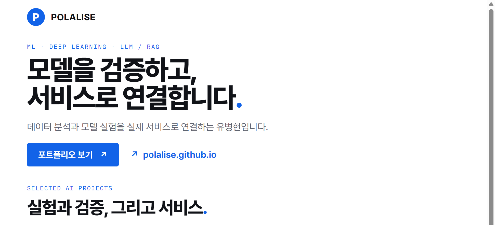
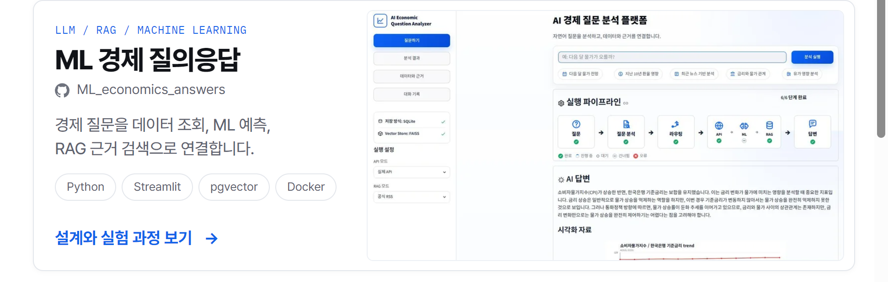
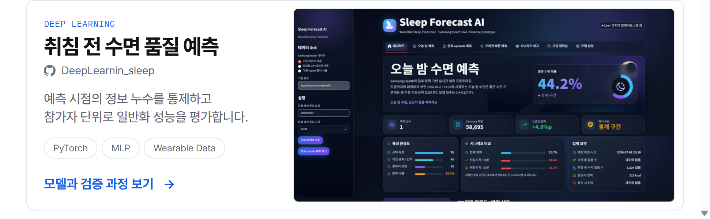
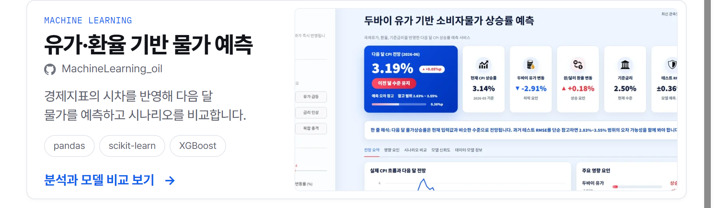
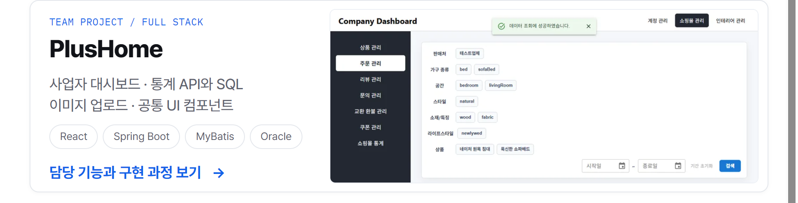

<!-- Editable artwork source: design/profile.html. Each panel links to its portfolio case study. -->

  <a href="https://polalise.github.io/"><picture><source media="(max-width: 640px)" srcset="assets/profile-v2/hero-mobile.png"></picture></a>
  <a href="https://polalise.github.io/projects/ml-economics-answers/"><picture><source media="(max-width: 640px)" srcset="assets/profile-v2/economics-mobile.png"></picture></a>
  <a href="https://polalise.github.io/projects/deep-learning-sleep/"><picture><source media="(max-width: 640px)" srcset="assets/profile-v2/sleep-mobile.png"></picture></a>
  <a href="https://polalise.github.io/projects/machine-learning-oil/"><picture><source media="(max-width: 640px)" srcset="assets/profile-v2/oil-mobile.png"></picture></a>
  <a href="https://polalise.github.io/projects/plushome/"><picture><source media="(max-width: 640px)" srcset="assets/profile-v2/plushome-mobile.png"></picture></a>
  <a href="https://polalise.github.io/"><picture><source media="(max-width: 640px)" srcset="assets/profile-v2/footer-mobile.png"></picture></a>

프로젝트 설명 · 소스 코드

# 유병현 · Polalise

데이터 분석과 모델 실험을 실제 서비스로 연결합니다. 머신러닝·딥러닝·LLM/RAG 응용을 중심으로, 웹 개발 경험을 함께 쌓고 있습니다.

[포트폴리오](https://polalise.github.io/) · [전체 프로젝트](https://polalise.github.io/projects/)

## ML_economics_answers

자연어 경제 질문을 공공데이터 조회, 통계 분석, ML 예측, RAG 근거 검색 가운데 필요한 경로로 연결하는 서비스입니다. 질문 라우터의 데이터 누수 가능성을 점검하고 수기 평가 문항으로 일반화 성능을 확인했습니다.

Python · Streamlit · scikit-learn · sentence-transformers · pgvector · Docker

[설계와 실험 과정](https://polalise.github.io/projects/ml-economics-answers/) · [소스 코드](https://github.com/Polalise/ML_economics_answers)

## DeepLearnin_sleep

수면 시작 전에 관측 가능한 웨어러블 데이터와 과거 수면 이력으로 다가오는 수면의 질을 예측합니다. 참가자 단위 평가와 기기 간 전이 진단을 통해 모델의 성능과 한계를 확인했습니다.

Python · PyTorch · MLP · Wearable Data

[모델과 검증 과정](https://polalise.github.io/projects/deep-learning-sleep/) · [소스 코드](https://github.com/Polalise/DeepLearnin_sleep)

## MachineLearning_oil

한국은행 월별 경제지표를 결합해 유가·환율의 시차를 반영한 다음 달 CPI 상승률을 예측합니다. 지속성 기준 모델과 여러 회귀 모델을 비교하고 결과를 Streamlit 대시보드와 시나리오 분석으로 연결했습니다.

pandas · scikit-learn · XGBoost · Streamlit

[분석과 모델 비교](https://polalise.github.io/projects/machine-learning-oil/) · [소스 코드](https://github.com/Polalise/MachineLearning_oil)

## PlusHome · 팀 프로젝트

가구 쇼핑과 인테리어 서비스를 연결하는 플랫폼입니다. 사업자 대시보드, 회사·업체 정보 관리, 관리자 화면과 공통 MUI 컴포넌트, 이미지 업로드·조회, 대시보드 통계 API와 MyBatis 쿼리, 프론트엔드·백엔드 연동을 담당했습니다.

React · MUI · Spring Boot · MyBatis · Oracle

[담당 기능과 구현 과정](https://polalise.github.io/projects/plushome/) · [소스 코드](https://github.com/Polalise/PlusHome)

