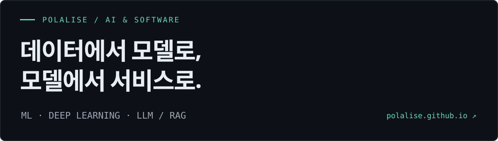

데이터를 분석하고, 모델을 검증하며, 사용 가능한 서비스로 연결합니다.  
**ML · Deep Learning · LLM / RAG**를 중심으로, 웹 서비스 개발 경험을 함께 쌓고 있습니다.

**[포트폴리오 전체 보기 →](https://polalise.github.io/)** · [프로젝트 모아보기](https://polalise.github.io/projects/)

---

## Selected AI Projects

### ML_economics_answers

**자연어 경제 질문을 데이터·예측·근거와 연결하는 질의응답 서비스**

경제 질문의 의도를 분석하고 공공데이터 조회, 통계 분석, ML 예측, RAG 검색 가운데 필요한 경로를 연결합니다.

- **설계:** 질문 라우터와 기능 가용성 점검을 통해 실행 경로를 결정합니다.
- **검증:** 템플릿 유사성에 따른 데이터 누수 가능성을 점검하고 별도 수기 평가 문항으로 일반화 성능을 확인했습니다.
- **구현:** Streamlit UI, 저장된 예측 모델, pgvector 기반 근거 검색을 하나의 파이프라인으로 구성했습니다.

`Python` `Streamlit` `scikit-learn` `sentence-transformers` `pgvector` `Docker`

**[설계·실험 과정 →](https://polalise.github.io/projects/ml-economics-answers/)** · [소스 코드](https://github.com/Polalise/ML_economics_answers)

---

### DeepLearnin_sleep

**수면 시작 전 관측한 데이터로 다가오는 수면의 질 예측**

이전 수면 이력과 취침 전 웨어러블 데이터를 사용해 수면의 질을 예측하는 PyTorch 프로젝트입니다.

- **설계:** 예측 시점 이후의 정보를 배제하는 pre-sleep 특성 생성 흐름을 구성했습니다.
- **검증:** 학습에 포함되지 않은 참가자를 대상으로 평가하고 불확실성을 함께 확인했습니다.
- **분석:** Samsung Health 데이터로 기기 간 전이를 진단하고 입력 데이터와 도메인 차이의 한계를 기록했습니다.

`Python` `PyTorch` `MLP` `Wearable Data` `Streamlit`

**[모델·평가·한계 →](https://polalise.github.io/projects/deep-learning-sleep/)** · [소스 코드](https://github.com/Polalise/DeepLearnin_sleep)

---

### MachineLearning_oil

**유가·환율 등 거시경제 지표를 활용한 다음 달 물가 상승률 예측**

한국은행 ECOS 월별 경제지표를 정리하고, 예측 모델을 비교해 Streamlit 대시보드로 연결했습니다.

- **분석:** 경제지표를 결합하고 변동률과 시차 변수를 생성했습니다.
- **검증:** 지속성 기준 모델과 여러 회귀 모델을 비교하고 MAE·RMSE·R²로 평가했습니다.
- **구현:** 예측 결과, 변수별 기여도, 조건 변화에 따른 시나리오를 시각화했습니다.

`Python` `pandas` `scikit-learn` `XGBoost` `Streamlit`

**[분석·모델 비교 →](https://polalise.github.io/projects/machine-learning-oil/)** · [소스 코드](https://github.com/Polalise/MachineLearning_oil)

---

## Web Development

### PlusHome

**가구 쇼핑과 인테리어 서비스를 연결하는 주거 통합 플랫폼 · 팀 프로젝트**

사용자 서비스와 사업자 운영 관리가 연결되는 React·Spring Boot 기반 플랫폼입니다.

**담당한 부분**

- 사업자 대시보드와 회사·업체 정보 관리
- 쇼핑몰·인테리어 관리자 화면과 공통 MUI 컴포넌트
- 이미지 업로드·조회 흐름
- 대시보드 통계 API와 MyBatis 쿼리
- 프론트엔드·백엔드 연동 환경 설정

`React` `MUI` `Spring Boot` `MyBatis` `Oracle`

**[담당 기능·구현 과정 →](https://polalise.github.io/projects/plushome/)** · [소스 코드](https://github.com/Polalise/PlusHome)

---

## Toolbox

| 분야 | 프로젝트에서 사용한 기술 |
| :--- | :--- |
| ML / DL | Python · pandas · NumPy · scikit-learn · XGBoost · PyTorch |
| LLM / RAG | Hugging Face · sentence-transformers · PostgreSQL · pgvector |
| Web / Delivery | Streamlit · React · Spring Boot · MyBatis · Oracle · Docker |

**[더 자세한 프로젝트 이야기와 결과는 포트폴리오에서 →](https://polalise.github.io/)**
